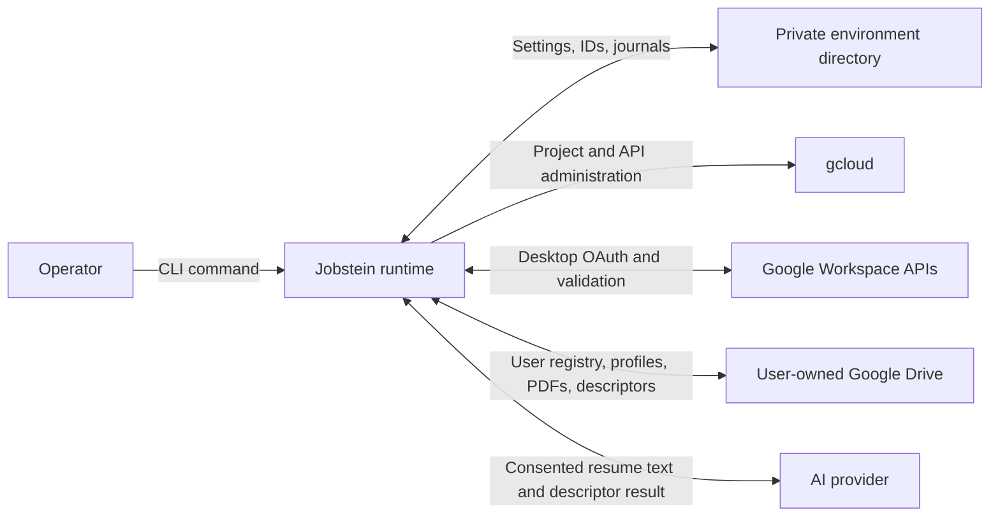
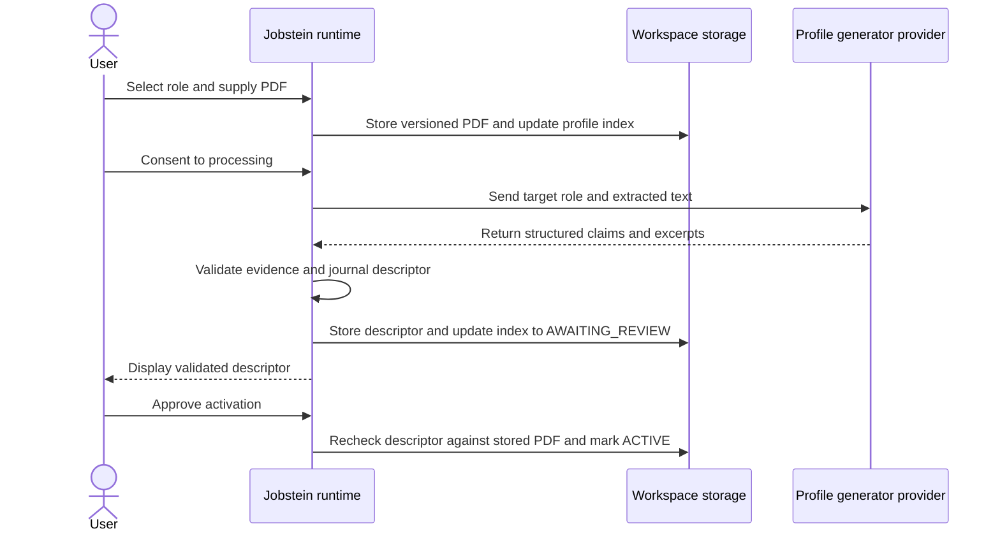
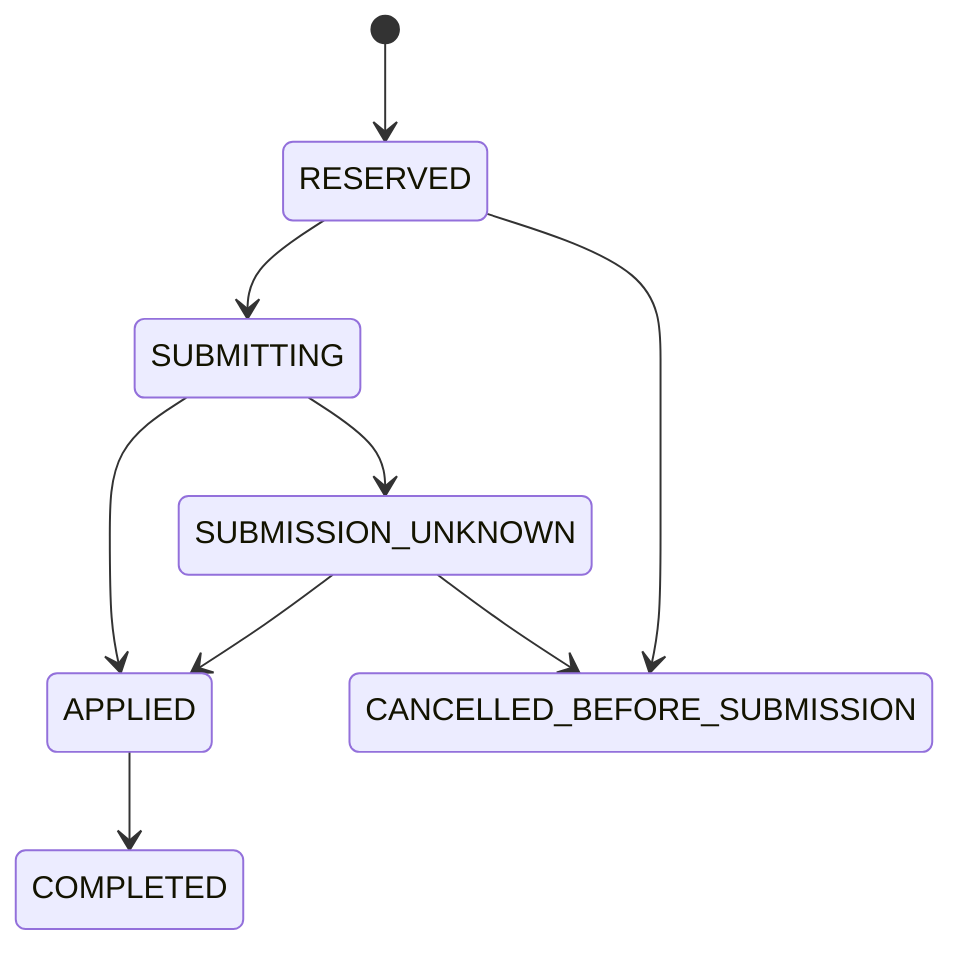

# How Jobstein works

## Runtime and storage

A **Jobstein runtime** executes work for a selected environment. Its current entry point is the Java CLI. An environment owns local configuration and credentials and, in live mode, binds to one Google project and authorized Workspace account. A user has a stable UUID and can own several role-specific applicant profiles. The profile UUID stays stable across resume and descriptor revisions.

The sandbox uses the same profile services with local workspace storage and mock AI. Live Drive access uses a desktop OAuth grant bound to the user's Google account subject. The runtime caches access tokens in memory and may retry a read once after HTTP 401. Mutations rely on recorded resource IDs and recovery journals for safe retries. The [onboarding guide](onboarding.md#what-exists-after-live-onboarding) lists the resulting files.

## Lifecycle of a runtime command

When you invoke an administrative command such as `onboard` or `doctor`, the CLI selects the environment and acquires its local lock. The runtime loads the environment's adapters, executes the command, reports the result, and releases the lock on exit. Checkpoints, resource IDs and profiles survive across commands. The lifecycle of the planned long-running runtime is still open.

## Profile lifecycle and data flow

On the usual path, a profile progresses from INITIALIZING through RESUME_UPLOADED and AWAITING_REVIEW to ACTIVE. Deactivation sets INACTIVE. Replacing the current PDF with different content returns the profile to RESUME_UPLOADED. A descriptor records the profile UUID, resume SHA-256, provider, integration and model.

Schema version 2 requires verbatim resume evidence after whitespace normalization. Matching text can still be misleading out of context, which is why activation requires human review. Version 1 descriptors require regeneration. A pending version 1 generation journal requires manual recovery before upgrade.

A single local writer coordinates changes. Folder and upload intents record allocated Drive IDs before creation. A durable descriptor payload can be reused after an interrupted upload. Profile index writes journal the before and after snapshots, update the remote copy, then the local copy, and verify agreement. An unexpected snapshot requires investigation. The environment lock cannot coordinate writers on different hosts. See [index recovery](operations.md#inspect-and-recover-profile-indexes).

## Job application lifecycle

The application registry is shared across all of a user's profiles. It reserves a canonical posting identity and checks aliases to catch duplicates across roles. These transitions exist in the storage service. A job discovery or submission runtime is future work.

A completed application still blocks another reservation for that posting. An uncertain submission also blocks duplicates until its outcome is reconciled. Cancellation before submission makes the posting eligible for reservation again.

## Agent types and instances

An **agent type** identifies an AI task. The implemented descriptor workflow resolves the ID `applicant-profile-generator` to a named integration and calls its provider. An explicit binding selects the whole integration. Without a binding, the environment default applies.

An **agent instance** would be an execution of an agent type within the runtime. Today descriptor generation is a direct call during a command. Instance identity, scheduling, concurrency and persistence are open design questions for the long-running runtime.

## Application UI in Google Docs

The planned user interface is a Google document with tabs. The Workspace adapter supports document reads and batch updates. Document creation for this UI, tab names and contents, which fields users can edit, and how edits reach the runtime are still to be designed. This section will describe the tab layout and the sequence from a document edit to a stored state change when those decisions are made.
