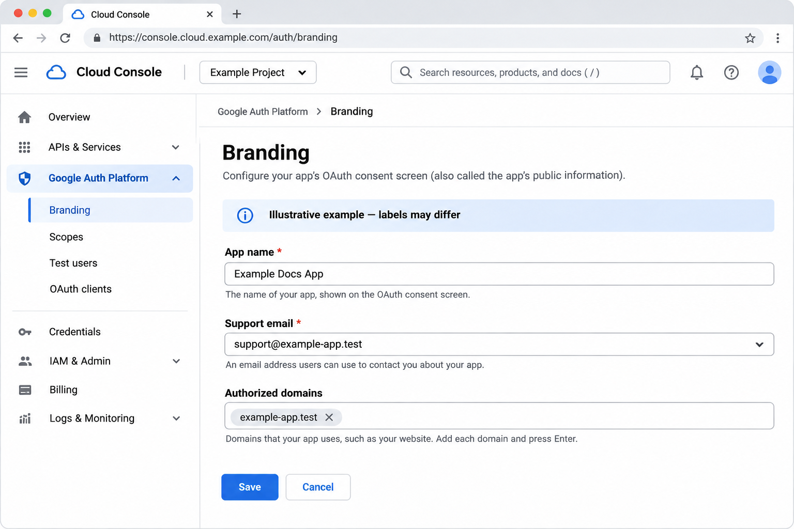
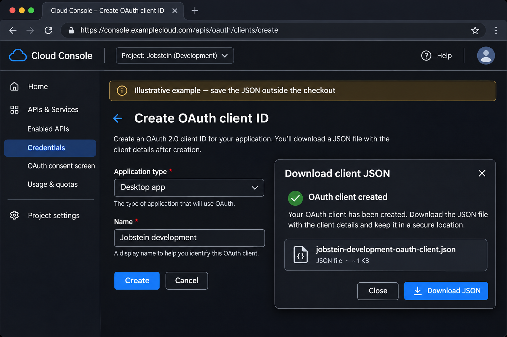

# Onboarding

Onboard once per environment. Success means the runtime can access its storage, resolve its default AI integration, and read an approved descriptor for the selected first profile. Onboarding ends by running the readiness checks and exiting.

## Try it in the sandbox

From the repository root on Linux, WSL 2, or in a [Codespace](https://codespaces.new/assafep/assaf-jobstein), build the CLI and run the synthetic workflow. See [development prerequisites](development.md) for Java and filesystem requirements.

```bash
bash scripts/setup-sandbox.sh
export PATH="$PWD/build/install/jobstein/bin:$PATH"
jobstein onboard --env sandbox
jobstein profile list --env sandbox
```

Look for `PASS Sandbox fixture ready` followed by `software.engineer ACTIVE` from the listing. The sandbox supplies the applicant, PDF, AI response and approvals. Google and xAI receive no requests. Under the sandbox environment directory, `simulation/` holds mock settings and `workspace-v2/` holds the simulated Drive, profile configuration, checkpoints and fixtures. Older sandbox layouts require onboarding again.

## Set up a live environment

Use a disposable Google account and development project for the first test. Live setup enables Google APIs, writes Drive files, and can incur costs. Use a synthetic text-based PDF. Keep the downloaded OAuth client and credentials outside the checkout and Drive.

1. Build the CLI as above. Install and authenticate the Google Cloud CLI for project administration. On Debian or Ubuntu, run these commands from the repository root:

   ```bash
   bash scripts/setup-live-tools.sh
   gcloud auth login --no-launch-browser
   bash scripts/live-preflight.sh
   ```

2. Choose the environment and GCP project. Use one project per live environment. From the repository root, start the guided browser sequence with your project ID:

   ```bash
   bash scripts/live-console-guide.sh YOUR_TEST_PROJECT
   ```

   The script prints the Auth Platform and Credentials links in order and pauses between them. The following console work is manual and must be completed in a browser:

   - In **Google Auth Platform**, configure the app branding and support email, choose the audience, add the disposable account as a test user, and configure the requested scopes. The required scopes are listed again in step 4. Use fictional or disposable values while developing.

     

     *Illustrative mockup only. Console labels and navigation may differ; do not enter real credentials into documentation examples.*

   - In **Credentials**, create an OAuth client with application type **Desktop app**, then download the client JSON. Store that file outside the checkout and do not commit it or place it in Drive.

     

     *Illustrative mockup only. The displayed project, filename and values are fictional.*

   The runtime enables the Drive, Docs, Gmail and Calendar APIs during Google configuration.
3. From a terminal, start the interactive workflow. Replace both example paths. The project ID is resolved from the downloaded OAuth JSON; you may provide `--project` only when you want to explicitly verify it matches. Always specify the environment explicitly because the administrative CLI defaults to production.

   ```bash
   jobstein onboard --env development \
     --oauth-client "$HOME/private/oauth-client.json" \
     --role "Software Engineer" --resume /absolute/path/to/synthetic-resume.pdf
   ```

4. Authorize the Workspace account in the browser. This grant binds user-owned files to an account separately from the gcloud login. For the consent screen, the scopes are `openid`, `userinfo.email`, `drive.file`, `gmail.readonly`, `gmail.compose` and `calendar.events.readonly`. For a remote terminal, set up the tunnel below first.
5. Choose the xAI model and enter credentials at the masked prompt. The runtime validates the default integration, then asks for the applicant's name and initializes the user and first role profile.
6. The runtime uploads the PDF. Give consent before it sends extracted text and the target role to the AI provider. Review the displayed descriptor before approving activation. A successful final doctor report includes `Configured checks passed (no email sent)`.

### Authorize from a private Codespace

Keep this SSH tunnel open on the workstation where you will use the browser, using a current GitHub CLI and OpenSSH.

```sh
gh codespace ssh -c YOUR_CODESPACE -- -N -L 127.0.0.1:8765:127.0.0.1:8765 -o ExitOnForwardFailure=yes
```

Add `--oauth-callback-port 8765 --no-browser` to the live onboarding command. Open the printed URL on the workstation. The browser redirects to the loopback address, which forwards the callback to Jobstein. Keep the port private and close the tunnel after authorization. Live validation of this workflow is pending.

## What exists after live onboarding

### In Google Drive

Production uses the root `jobstein/`. Other live environments use `jobstein-<environment>/`, for example `jobstein-development/`. Below that root, a fresh environment has this layout.

```text
<user-slug>/
  user.json
  _shared/
    application-registry.json
    profiles-index.json
    gmail-state.json
    calendar-state.json
    user-preferences.json
    automation-policy.json
  <role-slug>/
    job-preferences.json
    resume/<sha256>.pdf
    applicant-descriptor-<first-12-hash-characters>.json
    applications/active/
    applications/completed/
    artifacts/
```

The shared index records the selected profile as ACTIVE, with its UUID, resume version and descriptor file ID. The registry starts empty. The cursor, preference and policy files are schema seeds for future use. Folders and files have Drive IDs recorded by the runtime. Onboarding does not create the planned tabbed application UI.

### On the runtime host

Each live environment has its own directory under `~/.config/jobstein/environments/<environment>/`.

| Local state | Purpose |
| --- | --- |
| `environment.properties`, `google.yaml` | Environment name, schema version and bound GCP project |
| `credential-store.yaml`, `secrets/` | Selected file backend, OAuth client, refresh token and AI credentials. Access tokens are cached in memory during a command. |
| `ai.yaml` | Named integrations, provider fields, model, credential references, default integration and any agent bindings |
| `user.yaml`, `profiles.yaml` | Stable user UUID and Google account subject, plus the local copy of the profile index |
| `resource-manifest.yaml`, `upload-intents.yaml` | Logical resource names and allocated storage IDs used to find or safely reuse files |
| `provisioning-state.yaml`, `onboarding-first-profile.yaml` | Checkpoint outcomes and the selected first profile's role, slug and UUID |

Keep this directory private and preserve it between invocations. The supported credential backend uses owner-only POSIX file permissions. These files contain sensitive data in readable form.

## Resume interrupted onboarding

Run `jobstein onboard` again with the same environment and role. Completed Google, AI and user checkpoints are skipped. The runtime can reuse a stored resume and a journaled descriptor. It still requires approval before activating an unreviewed profile. A completed first-profile checkpoint revalidates that specific identity. If the selected profile is inactive or damaged, repair it before retrying. An older checkpoint with several existing profiles requires you to select the intended role.

To exercise recovery on a **fresh sandbox**, run `jobstein onboard --env sandbox --simulate-failure ai-configure`, then `jobstein doctor --env sandbox`. Expect the first command to fail and the second to report incomplete setup. Rerun onboarding without the failure flag.

Once ready, use [operations](operations.md) to work with the environment.
